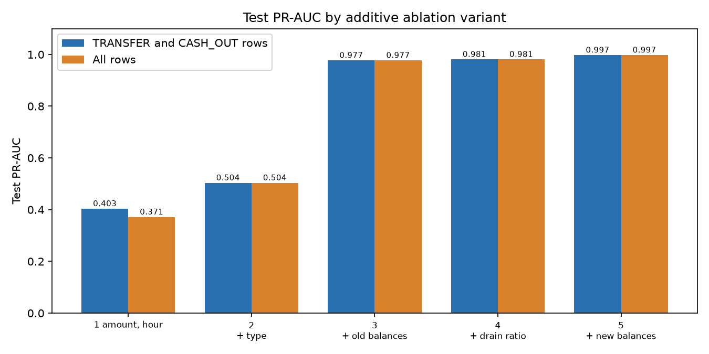
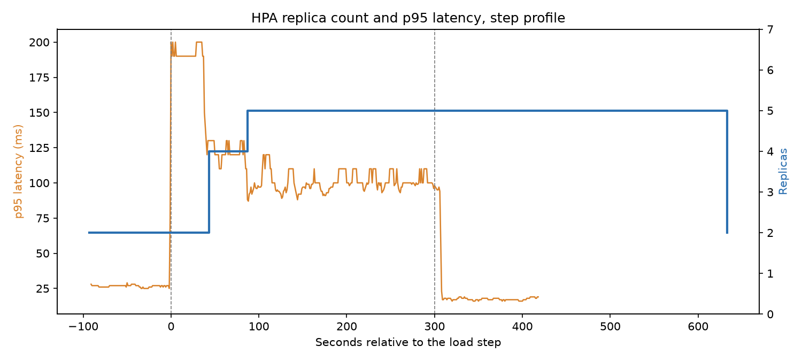
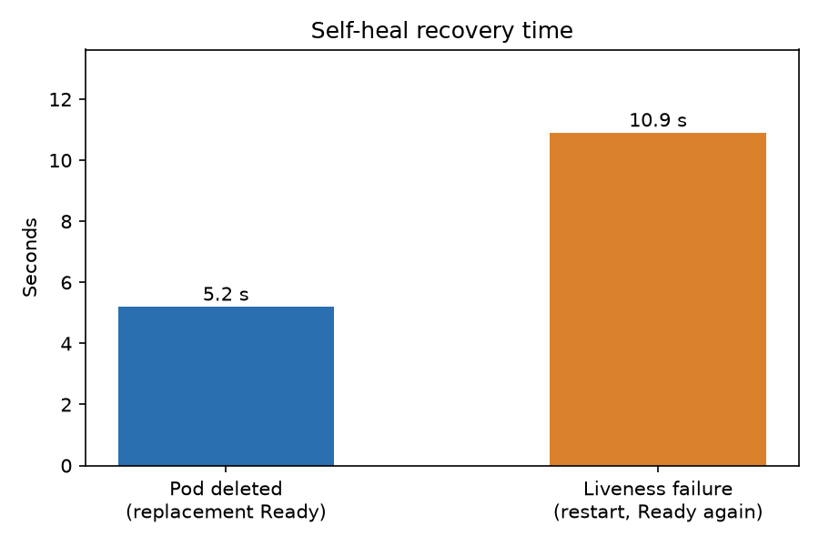
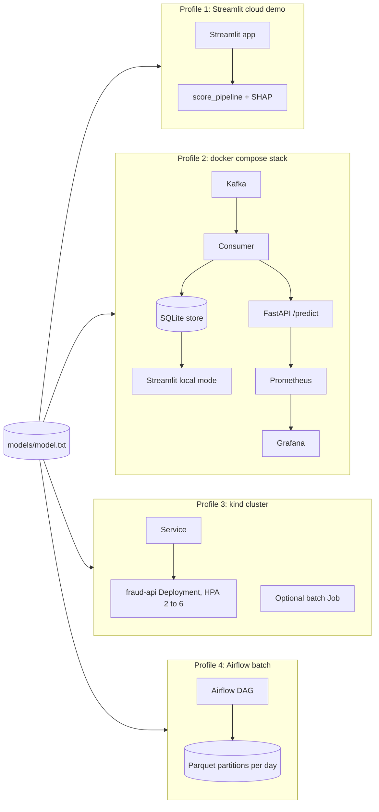
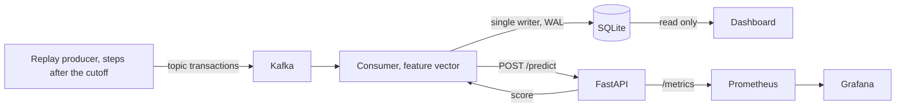
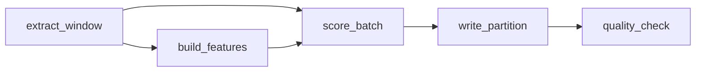

# E-Wallet Fraud Detection: End-to-End Real-Time and Batch Scoring with Monitoring

A single LightGBM classifier that scores e-wallet transactions for fraud risk, with four ways to run it: an in-process Streamlit demo, a local streaming stack, a Kubernetes serving demo, and an Airflow batch pipeline.

## Problem and approach

- **Data.** PaySim, a simulated mobile-money dataset: 6,362,620 transactions over steps 1 to 743 (1 step is 1 hour), 8,213 fraud rows (0.129%). All fraud is in TRANSFER and CASH_OUT.
- **Goal.** Score every transaction with a low false alarm rate, because blocking a legitimate user has a cost.
- **Model.** One LightGBM classifier with fixed hyperparameters and seed (300 trees, learning rate 0.05, 63 leaves, `class_weight="balanced"`, seed 42).
- **Features.** Only values known before a transaction executes: `hour_of_day`, `amount`, `oldbalanceOrg`, `oldbalanceDest`, the transaction type one-hot columns, and `orig_drain_ratio`. `newbalanceOrig` and `newbalanceDest` are excluded because they are written after execution. `isFlaggedFraud` is never used.
- **Split.** Temporal. Train on steps up to 594, test on steps 595 to 743.
- **Serving contract.** `/predict` is stateless and takes a ready feature vector. Feature computation lives in `src/feature_engineering.py`. Model loading and prediction live in `src/score_pipeline.py`, which the API, the dashboard, and the batch job all call.

## Results

All values come from files in `reports/`. Model metrics are on the temporal test split only (123,580 rows, 1,654 fraud rows).

### Model (`reports/model_evaluation.md`)

| Population | PR-AUC | Precision@100 | Precision@1,000 | Recall@1,654 |
|---|---|---|---|---|
| TRANSFER and CASH_OUT rows | 0.9809 | 1.0000 | 0.9980 | 0.9601 |
| All rows | 0.9807 | 1.0000 | 0.9980 | 0.9601 |

| Target recall | Flagged | False alarms | False alarm rate, TRANSFER and CASH_OUT | False alarm rate, all rows |
|---|---|---|---|---|
| 80% | 1,328 | 4 | 0.0081% | 0.0033% |
| 90% | 1,523 | 34 | 0.0685% | 0.0279% |

Additive ablation, test PR-AUC on TRANSFER and CASH_OUT rows:

| Variant | PR-AUC |
|---|---|
| 1. `amount`, `hour_of_day` | 0.4035 |
| 2. + type | 0.5036 |
| 3. + old balances | 0.9768 |
| 4. + drain ratio (final feature list) | 0.9809 |
| 5. + new balances (measurement only) | 0.9972 |



Loss and false alarm cost at each score cutoff, with every assumption stated, are in `reports/business_impact.md`.

### Serving (`reports/serving_benchmark.md`)

Single-node kind cluster, 2 to 6 API replicas, load generator on the same laptop.

| Experiment | Measured |
|---|---|
| Pod deleted, replacement Ready | 5.2 s |
| Liveness failure, Ready again | 10.9 s |
| Rolling update, failed requests | 0 of 11,453 |
| Recreate (comparison), failed requests | 83 of 9,308 |
| Rollback after a failed rollout, failed requests | 0 of 11,257 |
| Step profile, overload p95 against before | 7.04x |
| Step profile, p95 drop after scale-out | 47.4% (the 50% criterion was missed) |
| Stress profile, whole run | 346,667 requests, 823.7 RPS, 0 failures, p95 did not recover (210 ms) |





### Batch run (`reports/serving_benchmark.md`)

31 Airflow runs scored 6,362,620 rows in 11 min 16 s. A rerun of day 5 produced zero score difference. The quality check enforces matching row counts, no nulls, scores in [0, 1], and a score standard deviation above 0.

## Architecture



### Streaming flow



### Airflow DAG order



## Run instructions

Requirements: Windows with WSL2 or Linux, Python 3.11, Docker, `kind` and `kubectl` for the cluster demo. Keep the repository in the Linux filesystem and run one profile at a time.

### Data preparation

1. Download PaySim from Kaggle (dataset `ealaxi/paysim1`) and place the CSV at `data/paysim_transactions.csv`. PaySim is by Lopez-Rojas et al. The data and anything derived from it follow the dataset's own terms.
2. Set up and prepare:

```bash
make setup
.venv/bin/python -m src.prepare_data
make train
.venv/bin/python -m src.make_sample
make check
```

`make train` writes `models/model.txt`, `models/feature_list.json`, and `reports/metrics.json`. `make ablation` writes `reports/ablation.json` and its figure. Tests that need `data/processed` skip with a message when it is absent.

### Streamlit cloud mode

Run locally:

```bash
.venv/bin/streamlit run dashboard/app.py
```

Deploy on Streamlit Community Cloud:

1. Publish the repository to GitHub with `models/` and `data/sample/` included.
2. In Streamlit Community Cloud choose New app and select the repository and branch.
3. Set the main file path to `dashboard/app.py` and the Python version to 3.11.
4. Dependencies come from `dashboard/requirements.txt` and `packages.txt` (`libgomp1`).
5. Deploy. The app scores sample transactions in process and shows SHAP contributions. It calls no backend.

### Docker compose stack

```bash
make up
make down
```

`make up` creates `.env` from `.env.example` when missing, builds the images, and starts the API, Kafka, producer, consumer, dashboard, Prometheus, and Grafana. The dashboard is at `http://127.0.0.1:8501`, Prometheus at `http://127.0.0.1:9090`, Grafana at `http://127.0.0.1:3000`. `make down` removes the stack and its volumes. Change the placeholder passwords in `.env` before use.

### kind serving demo

```bash
make kind-up
make k8s-apply
make k8s-batch
make loadtest
make kind-down
```

`make kind-up` creates the cluster, installs metrics-server, and loads the API and batch images. `make k8s-apply` applies the manifests (Deployment with 2 replicas, Service, HPA, PodDisruptionBudget). `make k8s-batch` runs one batch scoring Job. `make loadtest` runs the self-heal, rollout, and autoscaling experiments and regenerates the serving report.

### Airflow

```bash
make airflow-up
make airflow-test
make airflow-down
```

`make airflow-up` prepares `.env` secrets and starts Airflow 3 with Postgres for metadata, with the UI at `http://127.0.0.1:8080`. The DAG `fraud_batch_scoring` runs daily with catch-up and writes `data/scored/date=YYYY-MM-DD/part-0.parquet`. `tests/test_dag.py` skips on the host because Airflow is not installed there. It runs through `make airflow-test`, which executes it inside the Airflow image.

### Charts

```bash
.venv/bin/python docs/make_figures.py
```

Regenerates the three charts in `docs/img/` from the files in `reports/`.

## Repository layout

```text
airflow/      Airflow image, environment script, and the batch scoring DAG
api/          FastAPI prediction service
dashboard/    Streamlit app with cloud and local modes
data/         PaySim inputs, processed Parquet, scored partitions, and the display sample
docker/       Dockerfiles, compose files, Prometheus and Grafana configuration
docs/         Chart script and generated images
k8s/          Kubernetes manifests for the kind cluster
loadtest/     Locust files, experiment scripts, and report generation
models/       Saved LightGBM model and feature list
notebooks/    EDA and modeling notebooks
reports/      Model evaluation, business impact, serving benchmark, and raw results
src/          Data preparation, features, training, evaluation, ablation, scoring, batch
streaming/    Kafka producer and consumer
tests/        Unit and integration tests
```

## Limits

- **Uneven daily volume.** Rows per day range from 272 to 574,255. Fraud rows per day stay between 216 and 320, so the daily fraud rate follows volume.
- **Last day is all fraud.** Day 30 (steps 721 to 743) has 272 rows and 272 fraud rows.
- **Simulator regularities.** 97.82% of fraud rows in TRANSFER and CASH_OUT drain the sender balance exactly, against 1 legitimate row. The PR-AUC reached with the balance features reflects how PaySim generates data and should not be expected to transfer.
- **Prevalence shift.** Fraud prevalence is 0.105% in the training steps and 1.338% in the test steps, so PR-AUC and Precision@K are not comparable with other splits.
- **Scores are not calibrated probabilities.**
- **Batch run.** Days 0 to 24 lie in the training range, so the batch run demonstrates the pipeline and is not a performance result.
- **Benchmarks.** They ran on a shared laptop with the load generator on the same CPUs as the cluster. Single-node kind shows mechanisms, not production capacity. Each run is a single execution.
- **Memory.** The compose stack used about 950 MiB. The Airflow stack peaked at about 7.8 GiB including page cache.
- **Single split and seed.** No confidence intervals.