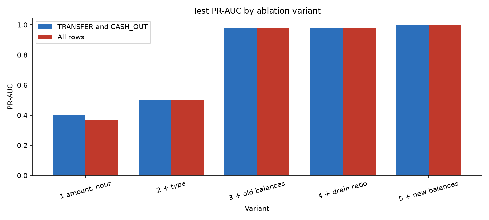

# Model Evaluation

One LightGBM model trained on PaySim transactions. The data is split by time: the model trains on steps 1 to 594 and is tested on steps 595 to 743. All results below come from the test part only. Model settings and the random seed are fixed in `src/config.py` (300 trees, learning rate 0.05, 63 leaves, extra weight on fraud rows with `class_weight="balanced"`, seed 42). There is no tuning.

**How to read the metrics**

- **PR-AUC:** the main score. It goes from 0 to 1, and higher is better. A random guess scores the same as the fraud share in the data.
- **Precision@K:** among the K rows with the highest scores, the share that is really fraud.
- **Recall@K:** the share of all fraud found in the top K rows.
- **False alarm:** a legitimate transaction flagged as fraud.

## Data

Numbers come from `reports/eda_numbers.json`. Charts are in `reports/figures/`.

- **Size:** 6,362,620 rows over steps 1 to 743 (24 steps per day). 8,213 rows are fraud (0.129%).
- **Train part:** 6,239,040 rows, 6,559 fraud (0.105%).
- **Test part:** 123,580 rows, 1,654 fraud (1.338%).
- **Old flag:** `isFlaggedFraud` marks 16 rows. All 16 are fraud, but it finds only 0.195% of fraud (8,197 fraud rows are not flagged). It is not used as a feature.
- **Accounts:** `nameOrig` is almost always unique (0.29% of rows share an account). `nameDest` repeats more (64.44% of rows share an account). No account history features are built.
- **Amounts:** in the test part, the median legitimate amount is 162,603.89 for TRANSFER and CASH_OUT rows, and 66,393.21 for all rows.

### Fraud by transaction type

Chart: `fraud_by_type.png`.

| Type | Rows | Fraud | Fraud rate |
|---|---|---|---|
| CASH_IN | 1,399,284 | 0 | 0% |
| CASH_OUT | 2,237,500 | 4,116 | 0.184% |
| DEBIT | 41,432 | 0 | 0% |
| PAYMENT | 2,151,495 | 0 | 0% |
| TRANSFER | 532,909 | 4,097 | 0.769% |

- All fraud is in TRANSFER and CASH_OUT.
- No row with a `nameDest` that starts with `M` is fraud (2,151,495 rows).

### Balance checks

Chart: `balance_evidence_by_label.png`. The checks use TRANSFER and CASH_OUT rows only (2,762,196 legitimate, 8,213 fraud), with a tolerance of 0.01.

| Check | Legitimate | Fraud |
|---|---|---|
| Sender balance falls by exactly the amount | 9.49% | 99.45% |
| Receiver balance rises by exactly the amount | 77.42% | 43.50% |
| Both of the above | 7.58% | 43.27% |
| Sender loses the full balance (`amount == oldbalanceOrg`) | 0.00004% (1 row) | 97.82% (8,034 rows) |
| Sender balance after the transaction is 0 | 90.10% | 98.05% |
| Receiver balance is 0 before and after | 0.062% | 49.63% |

### Daily volume

Charts: `fraud_per_step.png` and `fraud_rate_by_hour.png`. Daily numbers are in the `daily` block of `reports/eda_numbers.json`.

- Rows per day range from 272 (day 30, steps 721 to 743) to 574,255 (day 0).
- Fraud rows per day stay between 216 and 320, so the daily fraud rate follows the volume.
- Day 2 has 310 fraud rows out of 1,070 (29.0%).
- Day 30 has 272 rows, and all 272 are fraud (100%).
- The cutoff at step 594 falls inside day 24 (steps 577 to 600).

## Ablation

Five variants add features step by step. All variants use the same split, settings, and seed. The table shows PR-AUC on the test part. Variant 5 uses columns that are not in the final model. It is a measurement only.

| Variant | Features added | PR-AUC, TRANSFER and CASH_OUT | PR-AUC, all rows |
|---|---|---|---|
| 1 | `amount`, `hour_of_day` | 0.4035 | 0.3715 |
| 2 | type columns | 0.5036 | 0.5036 |
| 3 | `oldbalanceOrg`, `oldbalanceDest` | 0.9768 | 0.9768 |
| 4 | `orig_drain_ratio` (final model) | 0.9809 | 0.9807 |
| 5 | `newbalanceOrig`, `newbalanceDest` (measurement only) | 0.9972 | 0.9972 |

Scores are for TRANSFER and CASH_OUT rows, with the gain over the previous variant.

- **Variant 1 (0.4035):** `amount` and `hour_of_day` alone. This is well above the 3.225% fraud share in these rows. On all rows the score is lower (0.3715), because the model cannot tell which types never have fraud.
- **Variant 2 (0.5036, +0.1001):** the type columns let the model give low scores to CASH_IN, DEBIT, and PAYMENT. Both groups now score the same, because all fraud is in TRANSFER or CASH_OUT.
- **Variant 3 (0.9768, +0.4732):** the old balances give the biggest gain. 97.82% of fraud rows empty the sender balance, against 1 legitimate row. `oldbalanceOrg` is needed to see this. This variant adds two columns together, so their separate effects are not shown.
- **Variant 4 (0.9809, +0.0041):** `orig_drain_ratio` shows the same pattern directly. The gain is small, but it is positive on both groups.
- **Variant 5 (0.9972, +0.0163):** the new balances are known only after the transaction is done, so they cannot be used when a transaction is scored. This is not a usable feature set. The final model gives up 0.0163 PR-AUC to stay usable before the transaction is done.

## Results

Test part, final model. PR-AUC is computed with `sklearn.metrics.average_precision_score`. K values are 100, 500, 1,000, all test fraud (1,654), and 0.1% and 0.5% of the rows in each group. Precision@K is not shown when K is above the number of fraud rows (1,654).

### TRANSFER and CASH_OUT rows

51,286 rows, 1,654 fraud (3.225%). **PR-AUC: 0.9809.**

| K | Precision@K | Recall@K |
|---|---|---|
| 51 | 1.0000 | 0.0308 |
| 100 | 1.0000 | 0.0605 |
| 256 | 1.0000 | 0.1548 |
| 500 | 1.0000 | 0.3023 |
| 1,000 | 0.9980 | 0.6034 |
| 1,654 | 0.9601 | 0.9601 |

| Target recall | Score cutoff | Flagged | Fraud found | False alarms | False alarm rate |
|---|---|---|---|---|---|
| 80% | 0.99976 | 1,328 | 1,324 | 4 | 0.0081% |
| 90% | 0.98794 | 1,523 | 1,489 | 34 | 0.0685% |

### All rows

123,580 rows, 1,654 fraud (1.338%). **PR-AUC: 0.9807.**

| K | Precision@K | Recall@K |
|---|---|---|
| 100 | 1.0000 | 0.0605 |
| 124 | 1.0000 | 0.0750 |
| 500 | 1.0000 | 0.3023 |
| 618 | 1.0000 | 0.3736 |
| 1,000 | 0.9980 | 0.6034 |
| 1,654 | 0.9601 | 0.9601 |

| Target recall | Score cutoff | Flagged | Fraud found | False alarms | False alarm rate |
|---|---|---|---|---|---|
| 80% | 0.99976 | 1,328 | 1,324 | 4 | 0.0033% |
| 90% | 0.98794 | 1,523 | 1,489 | 34 | 0.0279% |

The flagged rows are the same in both groups. Only the false alarm rate differs, because the number of legitimate rows differs.

### Cost

The cost is measured at the score cutoff that reaches each target recall. All values use the same units as the `amount` column.

- **Missed loss:** the total amount of fraud that was not flagged.
- **Prevented loss:** the total amount of fraud that was flagged.
- **Total cost:** missed loss plus the cost of false alarms. The cost of one false alarm is an assumption, so three levels are shown.

| Target recall | Missed loss | Prevented loss | Total cost at 1,000 per false alarm | Total cost at 10,000 per false alarm | Total cost at 100,000 per false alarm |
|---|---|---|---|---|---|
| 80% | 53,652,378 | 2,668,782,191 | 53,656,378 | 53,692,378 | 54,052,378 |
| 90% | 24,564,265 | 2,697,870,304 | 24,598,265 | 24,904,265 | 27,964,265 |

These values are the same for both groups.

## Assumptions and limits

- **Different fraud share.** Fraud is 0.105% in the train part and 1.338% in the test part (3.225% in TRANSFER and CASH_OUT test rows). PR-AUC and Precision@K change with this share, so they cannot be compared with results from the full data or from a random split.
- **A pattern of the simulator.** In this data, 97.82% of fraud rows empty the sender balance, against 1 legitimate row. This is how the simulator creates fraud. In real systems, legitimate full withdrawals exist, so do not expect the same strength or the same PR-AUC.
- **Balance columns.** The old balances and the drain ratio are in the final model because they improve the results. The new balances are excluded, even though they raise PR-AUC to 0.9972, because they are known only after the transaction is done.
- **Cost of a false alarm.** It is set to 10,000, in the same units as `amount`. This is a business assumption that PaySim cannot give. It is 6.1% of the median legitimate amount in TRANSFER and CASH_OUT test rows. Results are also shown at 1,000 and 100,000.
- **Score cutoff.** The cutoff is chosen using the test labels. It shows what is possible, and it is not a cutoff for real use. The scores are model outputs, not true probabilities.
- **Targets and K values.** The recall targets (80% and 90%) and the K values are assumptions about how many cases a team can review. They do not come from the data.
- **One split, one seed.** All results come from one time split and one seed. No confidence ranges are computed.